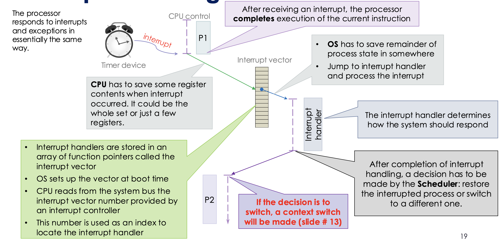
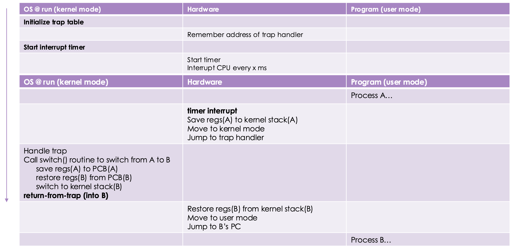

## Requesting OS services

!!! note "System calls"

    Used to request services from the kernel.

!!! info "System call protocol"

    The following shows how system calls are setup and executed. Recall OS is in kernel mode and program is in user mode.

    On OS boot:

    | OS | Hardware | Program |
    |---|---|---|
    | **Initialize trap table** | | |
    | | Remember address of syscall handler | |

    On program execution:
    
    | OS | Hardware | Program |
    |---|---|---|
    | Create entry for process list; Allocate memory for program; Load program into memory; Setup user stack with argv; Fill kernel stack with reg/PC; **return-from-trap** | | |
    | | Restores regs (from kernel stack) Move to user mode Jump to main | |
    | | | Run main() ... Call system call **trap** into OS |
    | | Save regs (to kernel stack) Move to kernel mode Jump to trap handler | |
    | Handle trap Do work of system call **return-from-trap** | | |
    | | Restore regs (from kernel stack) Move to user mode Jump to PC **after** trap | |
    | | | ... Return from main **trap** (via exit()) |
    | Free memory of process Remove from process list  | | |

## Virtualization

!!! Note "Virtualization"

    Allow each process to share the same CPU via [scheduling](scheduling), provide each process with it's own *virtual* CPU.

Goals:

* Transparently & temporarily switch (stop / resume) between processes $\rightarrow$ **Context switching**
* Allow OS to regain control of the CPU

### Switching processes

!!! info "Context switching"

    To switch from one process to another, the kernel performs a context switch:
    1. Suspend the progression of current process, update & schedule, [store context](#kernel-stack)
    2. Identify next process by [scheduling](scheduling)
    3. Locate the next process's register context from it's PCB
    4. Retrieve the context of another process and restore it to the CPU
    5. Resume execution of the new process, update & schedule

    Update & schedule involves updating PCB values, relevant statuses and [scheduling](scheduling) the process.

!!! note "Kernel stack"

    Stores & restores the following information when context switching:
    * CPU regsters
    * Program counter
    * Kernel stack pointer

!!! note "Context switching overhead"

    Context switching will have some indirect costs:
    * New process may not have needed data / instructions in physical memory
    * New process does not have any part of it's address space in cache

!!! info "Mode switch vs. Context switch"

    Mode switch:

    * Switching from user mode to kernel mode
    * the Kernel is said to be "executing on behalf of the process"
    * the process's context remains accessible (e.g., address space)
    * upon exiting kernel, the process may resume and return to execute in user space

    Context switch $\Rightarrow$ Mode switch, but not vice versa.

### To regain control of the CPU

We need to regain control of the CPU from user processes when something goes wrong.

!!! note "Exceptions"

    * Interrupts triggered by a running process
    * Unexpected events **within** the processor

!!! tip "Timer interrupts"

    * Triggered by hardware device
    * OS to respond to alerts from hardware

!!! info "Handling interrupts"

    

    

... TBC
