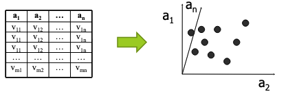

## Multidimensional data

Many data types are really *tables of objects with several attributes*, so each object can be expressed as a **point in n-dimensional space**.

Attributes can be numerical (ordinal) *(age, salary)*, categorical *(color)*, or binary *(gender)*.

## Basic queries

* **Range query**: Find all objects in a given range of values for each attribute.
* **Distance query**: Find all objects within a given distance `d` from a reference record.
* **Nearest neighbor query** (kNN): Replaces the distance query's `d` bound with a number `k` of nearest neighbors to find (ranking)

## Top-k queries

!!! tip "Top-k queries"

    Find the `k` best objects according to an aggregate function `f`. Attributes values are normalized to `[0, 1]` to avoid biasing the aggregate function.

    Top-k generalizes kNN: kNN ranks by one attribute `d`, whereas top-k ranks by an aggregate function `f` of multiple attributes.

    <BlockSep />

    Relational table containing inforation about restaurants with attributes `price`, `quality` and `location`. 

    An example function can be `f: sum(-price, quality, -spd(location, my_hotel))`, which ranks restaurants by low price, high quality and close location.

!!! note "Variants of top-k queries"

    * **Single table vs. ranked lists**: data can be in one table, or sorted lists of each attribute.
    * **Centralized vs. distributed**: lists may sit on one machine or on different servers, and a merger combines them

!!! tip "Evaluation assumption"

    Most algorithms assumes `f` is:
    1. **Distributive**: `f(x,y,z) = f(f(x,y), z)`, so partial results can be combined to get the final result *(e.g. a `sum` function is distributive)*
    2. **Monotone**: if `x >= y` then `f(x, z) >= f(y, z)`, so if a record is worse than another in all attributes, it cannot be in the top-k.

### Rank aggregation evaluations

Each attribute has its own ranked list, accessed sequentially and/or randomly.

**Pros**: 
* Works on any subset of attributes
* Suits distributed data
* Easy to implement

**Cons**:
* Slower than index-based methods
* Needs sorted inputs

!!! info "Threshold algorithm (TA)"

    Consider multiple ranked lists with values `attr[j][i] = (r_ji, v_r)` where `r_ji` is the record and `v_r` is the value of the attribute `j` for that record. 
    
    TA process the ranked lists *row by row*. To find the best `k` records for an aggregate function `f` with `n` ranked lists:

    1. For row `i`, compute `f(r_ji)` for each `n` lists
    1. Maintain **sorted** return list `topk[1..k]: r` of top-k records
    1. Update threshold `T=f(attr[1][i], ..., attr[n][i])` \*
    1. Stop when `f(topk[k]) >= T`.

    \*: By **monotonicity**, any record not yet seen cannot have `f(r) > T`.

    <BlockSep />

    Consider following `attr` with `k=2` and `f: sum`:

    | S1 | S2 | S3 |
    |----|----|----|
    | c 0.9 | a 0.9 | c 0.9 |
    | d 0.8 | b 0.8 | a 0.9 |
    | b 0.6 | e 0.6 | b 0.8 |
    | e 0.3 | d 0.4 | d 0.6 |
    | a 0.1 | c 0.2 | e 0.5 |

    Compute:

    | `i` | Access | Computed (new) | `topk` | `T` | Stop? |
    | --- | --- | --- | --- | --- | --- | 
    | 1 | c, a, c | f(c) = 2.0, f(a) = 1.9 | `[c, a]` | `0.9+0.9+0.9=2.7` | No (`f(topk[2]) = 1.9 < T`) |
    | 2 | d, b, a | f(d) = 1.8, f(b) = 2.2 | `[b, c]` | `2.5` | No (`f(topk[2]) = 2.0 < T`) |
    | 3 | b, e, b | f(e) = 1.4 | `[b, c]` | `2.0` | Yes (`f(topk[2]) = 2.0 <= T`) |

    Returned: `[b, c]` with `f(b) = 2.2`, `f(c) = 2.0`.

!!! info "No random access algorithm (NRA)"

    NRA also processes the ranked lists *row by row*, but it **never performs random accesses**. Since a record's full score is usually unknown, NRA maintains bounds for every record seen so far. To find the best `k` records for an aggregate function `f` with `n` ranked lists:

    1. For row `i`, read `attr[j][i]` for each of the `n` lists (sorted access only)
    1. For each record `x` seen so far, update the bounds \*:
        - `lb(x)`: `f(x)` with every unseen attribute set to the worst value (`0`)
        - `ub(x)`: `f(x)` with every unseen attribute set to the last value seen in that list
    1. Maintain `W[1..k]: r`, the `k` records with the largest `lb`
    1. Stop when `min lb(W) >= max ub(x)` over all `x` not in `W` (an unseen record has `ub = f(attr[1][i], ..., attr[n][i])`).

    \*: By **monotonicity**, the score of `x` can never exceed `ub(x)` or fall below `lb(x)`. NRA may stop without knowing the exact score of every record.

    <BlockSep />

    Consider following `attr` with `k=2` and `f: sum`:

    | S1 | S2 | S3 |
    |----|----|----|
    | c 0.9 | a 0.9 | c 0.9 |
    | d 0.8 | b 0.8 | a 0.9 |
    | b 0.6 | e 0.6 | b 0.8 |
    | e 0.3 | d 0.4 | d 0.6 |
    | a 0.1 | c 0.2 | e 0.5 |

    Compute (bounds are `[lb, ub]`):

    | `i` | Access | Bounds (seen records) | `W` | Stop? |
    | --- | --- | --- | --- | --- |
    | 1 | c, a, c | c `[1.8, 2.7]`, a `[0.9, 2.7]` | `[c, a]` | No (`min lb(W) = 0.9 < 2.7`, unseen records have `ub = 2.7`) |
    | 2 | d, b, a | c `[1.8, 2.6]`, a `[1.8, 2.6]`, d `[0.8, 2.5]`, b `[0.8, 2.5]` | `[c, a]` | No (`1.8 < ub(d) = 2.5`) |
    | 3 | b, e, b | b `2.2`, c `[1.8, 2.4]`, a `[1.8, 2.4]`, d `[0.8, 2.2]`, e `[0.6, 2.0]` | `[b, c]` | No (`1.8 < ub(a) = 2.4`) |
    | 4 | e, d, d | b `2.2`, c `[1.8, 2.2]`, a `[1.8, 2.1]`, d `1.8`, e `[0.9, 1.5]` | `[b, c]` | No (`1.8 < ub(a) = 2.1`) |
    | 5 | a, c, e | b `2.2`, c `2.0`, a `1.9`, d `1.8`, e `1.4` | `[b, c]` | Yes (`min lb(W) = 2.0 >= ub(a) = 1.9`) |

    Returned: `[b, c]` (ties between `lb`s broken arbitrarily), with `f(b) = 2.2`, `f(c) = 2.0`.

!!! note "NRA vs. TA"

    | | TA | NRA |
    |---|---|---|
    | Access types | Sorted and random | Sorted only |
    | Stopping rule | k-th best score ≥ T | min lb in $W_k$ ≥ max `ub` outside $W_k$ |
    | Scores | Exact for each seen object | Bounds, possibly never exact |
    | Overhead | Costly random accesses | Bound storage for all seen objects |
    | Best when | Random access is cheap | Random access is costly or impossible |

### Multidimensional indexing evaluations