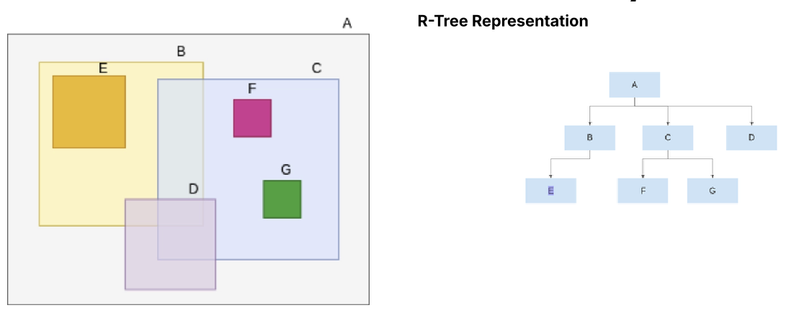

Traditional relational DBs cannot natively support complex operations over huge amount of spatial data. Spatial databases are designed to store and query spatial data efficiently.

## Spatial relationships

!!! note "Objects"

    Each object is represented by a (finite or infinite) set of points

    * boundary: set of points that are on the edge of the object
    * interior: set of points that are inside the object. Some objects (e.g. points, lines) do not have an interior.

!!! note "Topological relationships"

    Defined by a set of (set-based) relationships between their boundaries and interiors.

    The following are the hierarchy of topological relationships between two objects:

    ```mermaid
    graph TD
        ANY --> intersects
        ANY --> disjoint
        intersects --> adjacent
        intersects --> contains
        intersects --> inside
        intersects --> equals
    ```

!!! note "Distance relationships"

    Defined by the distance between the objects.

!!! note "Directional relationships"

    Defined by the relative position of the objects.

The relationships can be combined. For example: "My house is <ColorBox color="red">**disjoint**</ColorBox> from the park, <ColorBox color="blue">**100 meters**</ColorBox> <ColorBox color="purple">**north of**</ColorBox> it."

## Queries

Queries on spatial relationships.

!!! note "Minimum bounding rectangle (MBR)"

    The smallest rectangle that contains the object.

!!! info "Two-step spatial query processing"

    * Approximate objects by MBR
    * **Filter**: Test against the query predicate
    * **Refine**: Test the actual objects against the query predicate

## Spatial access methods

It is difficult to index spatial data - no dynamic access methods with good theoretical worse-case performance guarantees.

Therefore, **Spatial Access Methods (SAMs)** are used to minimize the expected cost.

### Evolution

Point access methods...

TBC...

## R-trees

They're conceptually similar to [B+ trees](indexes/#b-trees), but for spatial data.

!!! tip "R-tree"

    Properties:
    * Leaf nodes: `<MBR, id>`
    * Non-leaf nodes: `<MBR, ptr>`
    * Parameters, except for the root node:
        * Minimum number of entries: $m$
        * Maximum number of entries: $M$
        * $m \leq \frac{M}{2}$
        * Usually $m=0.4M$
    * MBR of a non-leaf node is the MBR of its children

    <BlockSep />

    

### R*-trees

A R*-tree is an improved version of the R-tree, which uses a different **insertion** strategy to produce a better tree that matches the following criterions:

| Criterion | Explaination | 
|---|---|
| Small area | Reduce *dead space* where the MBR doesn't contain any object and thus can waste I/O |
| Small overlap | Reduce *sibling overlap* which when hit means multiple branches need to be searched |
| Small margin / perimeter | Square MBRs are better than thin ones | 
| High storage utilization | Fuller nodes mean fewers nodes |

!!! info "R*-tree insertion path"

    *Insertion*:
    * At a high-level node, pick the child whose MBR needs the **least enlargement** to include the new object.
    * When the node's objects are at the leaf level, pick the entry whose enlargement causes the **least overlap** with its siblings. \*
    * If there is a tie, pick the one with the **least area**.

    \*: More expensive to compute, but overlap matters most at the bottom

!!! info "R*-tree insertion node splitting"

    *Node splitting*: When insertion causes overflow ($M+1$ entries):
    * For each *axis*:
        * Sort objects by lower and upper value
        * For each sort, try every split point $k \in [m, M+1-m]$
        * For each $k$, put first $k$ entries in group A and the rest in group B, and compute $sum_k = sum_k + margin(A) + margin(B)$
    * Choose to split by *axis* with the **least** $sum$

!!! info "R*-tree insertion forced reinsert"

    Before splitting an overflowing node, the R*-tree tries to relieve it instead:
    * Take **30% of the entries furthest from the node's center** and remove them
    * Reinsert them from the top of the tree, which may cause them to go into a different node
    * One-off per overflowed node

    It costs a bit mroe per insert, but it gives better overall tree quality and reduces the number of splits.

### Bulk loading R-trees

If the dataset is static and known up front, inserting one by one is slow, and it leaves nodes only partly full. Bulk-loading sorts the data and builds the tree bottom-up.

!!! info "Bulk loading R-tree methods"

    * **x-sorting**: Sort rectangles by the x-coordinate of their center, pack M consecutive ones into each leaf, then build the upper levels the same way. It is fast and the leaves are full, but the leaf MBRs become long vertical stripes.
    * **Hilbert sorting**: Order rectangles along a space-filling curve, which keeps nearby objects close together in the order. The structure is much better, but overlap is still large.
    * **Sort-Tile-Recursive (STR)**: Sort by x and cut into vertical slices. Within each slice, sort by y and pack into leaves. The leaves come out roughly square, and this is usually the best bulk-loading method.

## Queries on R-trees

!!! info "Range query"

    Searching for objects with relationship with MBR `W`:

    ```py
    def range_query(W, node n):
        if not n is leaf:
            for c in n, predicate(c.MBR, W):
                range_query(W, c.ptr)
        else:
            for c in n, predicate(c.MBR, W):
                o = object(c.id)
                if predicate(o, W) yield o
    ```

    Where `predicate` is the relationship between the object and the MBR, for example, `intersects`, `contains`, `equals`, etc.

### Nearest neighbor query

Problem: Given a query object `q`, find the object `o_nn` in the dataset that is closest to `q`.

!!! info "Depth-first NN search"

    ```py
    def nn_search(q, node n, o_nn): # init o at inf
        if n is not leaf:
            for c in n, dist(c.MBR, q) < dist(best.MBR, q):
                nn_search(q, c.ptr, o_nn)
        if n is leaf:
            for c in n, dist(c.MBR, q) < dist(best.MBR, q):
                o = object(c.id)
                if dist(o, q) < dist(q, o_nn):
                    o_nn = o
    ```

    **Pros**: Simple, easy to implement, and works well for small datasets.

    **Cons**: For large datasets, it may traverse many nodes that are far away from the query object, which is inefficient.

!!! info "Best-first NN search"

    ```py
    def nn_search(q, node n):
        Q = priority_queue() # min-heap
        Q.push(n, dist(n.MBR, q))
        while not Q.empty():
            n = Q.pop()
            if n is leaf:
                for c in n:
                    o = object(c.id)
                    if dist(o, q) < dist(q, o_nn):
                        o_nn = o
            else:
                for c in n:
                    Q.push(c.ptr, dist(c.MBR, q))
    ```

    **Pros**: Always traverses the closest nodes first, which is more efficient for large datasets.

    **Cons**: More complex to implement and requires a priority queue.

### Indexed intersection joins

If both datasets are indexed by R-trees, we can perform a R-tree join (RJ) to find all pairs of objects that intersect:

!!! info "R-tree Join (Synchronized Traversal / RJ)"

    **Core observation.** If two directory nodes, $n_R$ and $n_S$, have MBRs that do not intersect, then no object in the subtree of $n_R$ can intersect any object in the subtree of $n_S$.

    The algorithm recursively traverses both trees in parallel, then only considers pairs of entries whose MBRs intersect.

    Consider query: *"Find pairs $(r,s)$ s.t. $r \in R$, $s \in S$, and `r.MBR.intersects(s.MBR)`"* ($R, S$ are nodes of R-trees of two datasets)

    ```py
    def RJ(R, S):
        for (r, s) in R x S: # unoptimized
            if r.MBR.intersects(s.MBR): # unoptimized
                if R.is_leaf:
                    yield (r.oid, s.oid)
                else:
                    RJ(r.ptr, s.ptr)
    ```

!!! info "RJ Optimizations"

    We can perform optimizations on `R x S` to reduce the number of pairs we need to consider:

    ```py
    def RJ(R, S):
        # perform space restriction to reduce the number of pairs to consider
        R_sr, S_sr = sr(R, S) 
        # planesweep to find intersecting pairs instead of looping through all pairs
        for (r, s) in planesweep(R_sr, S_sr): 
            if R.is_leaf:
                yield (r.oid, s.oid)
            else:
                RJ(r.ptr, s.ptr)
    ```

    *Space restriction*: Only consider entries which intersect with the MBR of the other parent node:

    ```py
    def sr(R, S):
        I: MBR = R.MBR.intersection(S.MBR)

        R_sr = {r in R | r.MBR.intersects(I)}
        S_sr = {s in S | s.MBR.intersects(I)}
        return R_sr, S_sr
    ```

    *Sweep join*: Sort entries by their lower x-coordinate, then only consider pairs whose x-intervals overlap. Total cost is $O((N+M)\cdot log(max(N,M)) + k)$

    Steps:
    1. **Sort** both lists by the lower x-value of each MBR (the left edge).
    2. **Sweep** a vertical line left to right. At each step, take whichever list has the entry with the smaller lower-x. Call that entry `t`.
    3. **Scan forward in the other list** from its current position, for as long as the entries there start at or before `t`’s right edge (x-overlap). For each such entry, check y-overlap. Report the pair if it overlaps. Then advance past `t` in its own list.

### Partially indexed intersection joins

*Indexed nested loops* runs a window query on the R-tree for every object of the unindexed set. It is simple, but one query per object adds up.

*Seeded tree join and Bulk-load and Match* build an R-tree on the fly for the unindexed set, then use R-tree join.

*Sort and Match* sorts the raw data and packs leaf nodes, but never builds the upper levels. It matches the packed nodes directly against the existing tree.

*Slot-index spatial join* hashes the raw data against entries of a high level of the R-tree, then matches each bucket in memory with plane sweep.

### Refinement step

An MBR pair that intersects may still have non-intersecting objects (a false hit). Running exact geometry tests on every candidate is expensive, so a cheap middle step is added:

1. *Step 1*: MBR intersection, which is the R-tree join.
2. *Step 2*: use better approximations of each object.
    * Conservative approximations (e.g., convex hull) contain the object. If these don’t intersect, the pair is definitely a false hit and can be discarded.
    * Progressive approximations (e.g., maximum enclosed rectangle) lie inside the object. If these intersect, the pair is definitely a true hit and can be reported immediately.
3. *Step 3*: only pairs still undecided go to exact computational-geometry tests.

This is the same filter-and-refine idea you saw earlier for selections, with an extra stage to avoid most of the exact tests.

## Non-indexed intersection joins

If the two datasets are *not indexed*, we can use the following methods for intersection joins:

!!! info "Spatial hash join"

    Partitions both sets irregularly, with partitions adapted to the data.

!!! info "Partition based spatial merge join"

    Uses regular tiles, hashes objects into the tiles they overlap, and then joins each tile.